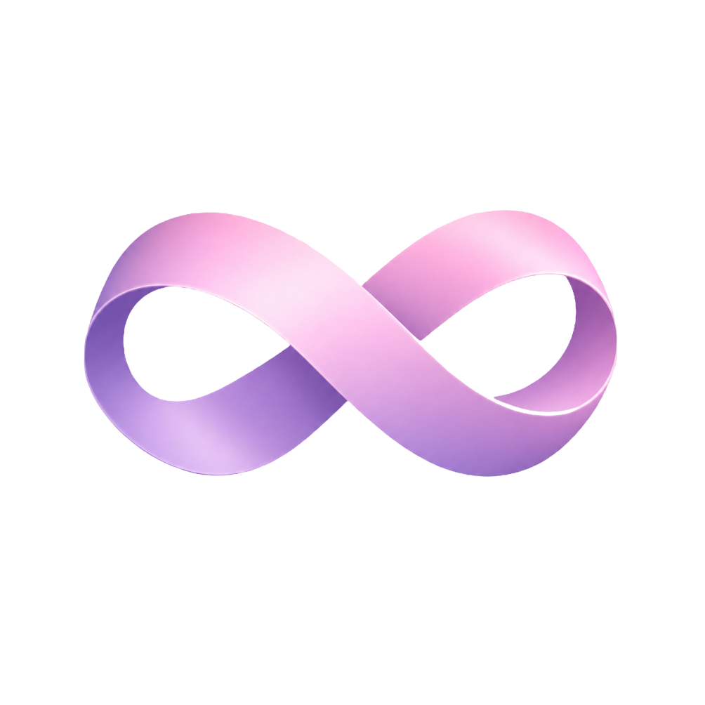

<div align="center">



# Mobius

### A self-evolving agentic development environment

**Mobius gets smarter the more you use it.** It observes how you work, distills successful operations into reusable **Skills**, and then automatically matches the most relevant Skill to each task through an intent-recognition based recommendation algorithm — the Agent's capabilities accumulate with use, instead of starting from zero with every conversation.

[](LICENSE.txt)
[]()
[]()
[-purple)]()

[English](README.md) · [简体中文](README.zh-CN.md)

</div>

---

## Why Mobius

Most AI IDEs are stateless: every conversation is a brand-new prompt, and when you close the tab, the "Agent" forgets everything.

Mobius is different. It is an **ADE — Agentic Development Environment** — built around one core idea:

> An AI coding partner should accumulate skills, not just consume tokens.

Mobius is built on a [VS Code](https://github.com/microsoft/vscode) fork with the [Continue](https://github.com/continuedev/continue) agent engine built in, and adds three layers on top of it:

| Layer | Purpose |
|---|---|
| 🧠 **Self-summarizing Skills** | Distills successfully completed Agent tasks into reusable, versionable Skills (Markdown playbooks + tool sets). The more tasks you complete, the richer your Skill library becomes. |
| 🎯 **Intent → Skill recommendation** | Hybrid embedding + lexical retrieval that reads the intent of your request and automatically preloads the most relevant Skills into the Agent's context — no need to type `/skill` manually. |
| 🔄 **RSI** | *Recursive Self-Improvement*. Inside a **controlled sandbox** (hidden acceptance test set, independent evaluator, quality gates, human approval), let the Agent propose changes to its own Skills, validate them automatically, and only promote winning candidate versions. Wired into the live Skill engine, plus a runnable reference loop in [`rsi-test/`](rsi-test/README.md). |

The end result: an IDE whose Agent grows more capable the longer you use it — every success you have becomes its instinct.

---

## Feature Highlights

- **Built on the VS Code OSS fork** — full editor experience, extensions, keybindings, themes.
- **Continue built in** — chat, inline editing, `@codebase` repository indexing, autocomplete.
- **Local embeddings + OCR** — `@codebase` uses in-process `transformers.js` (`all-MiniLM-L6-v2`); GLM-OCR still runs on bundled Ollama. Chat uses cloud models.
- **Skill system** — file-based Skills in `.agents/skills/`, hot-reloadable and shareable via git.
- **Intent-driven Skill matching** — hybrid recall (embedding + lexical) scores Skills for every query and preloads the top matches.
- **Pluggable agent harness (roadmap)** — Continue is currently the built-in and only harness; the roadmap extracts a thin harness abstraction so multiple agent engines (such as DeepSeek's agent harness) can coexist as plugins that complement Continue, rather than replacing it.
- **Multi-agent tool superset** — both Continue and GitHub Copilot Chat tools are provided by default (`MOBIUS_SKIP_COPILOT=1` to toggle).
- **RSI loop** — sandboxed self-improvement with training/acceptance data isolation, 5 quality gates, human approval, and one-step rollback. Live engine in the workbench (`continue.rsi.mode`: off/shadow/enforce) + [`rsi-test/`](rsi-test/README.md) reference loop (`npm run rsi:test`).

---

## Architecture

```
Mobius/
├── vscode/                # Mobius workbench (VS Code fork, submodule)
├── continue/              # Continue agent engine → linked to vscode/extensions/continue
├── hermes-agent/          # Reference agent loop / skills / memory (read-only submodule)
├── rsi-test/              # RSI (Recursive Self-Improvement) reference loop
├── .agents/skills/        # ← Where Mobius Skills live (auto-discovered)
│   ├── auto/              # Agent self-summarized skills (auto-loaded)
│   └── rsi/               # RSI sandbox: acceptance.json (human-owned), champion.json, history/
├── resources/ollama/      # Bundled Ollama runtime (amd64 + arm64) — OCR model only (no embeddings/chat)
├── scripts/               # Build / launch / packaging automation scripts (PowerShell, Bash)
├── config/                # Continue + Mobius configuration templates
└── .env                   # AI provider keys (synced to ~/.continue/config.yaml)
```

See [REBASE.md](REBASE.md) for the rebase workflow against the VS Code / Continue upstreams. `hermes-agent` is a read-only reference submodule from [NousResearch/hermes-agent](https://github.com/NousResearch/hermes-agent), used to study its agent loop, skills, and memory design.

---

### Quick Start

#### Windows

```powershell
# 1. Clone (including submodules)
git clone --recurse-submodules https://github.com/<your-org>/mobius.git
cd mobius

# 2. Configure the AI provider
copy .env.example .env
notepad .env   # fill in OPENAI_API_KEY (or any OpenAI-compatible endpoint)

# 3. Verify the toolchain
npm run check

# 4. First build (~20–40 minutes: Continue + Mobius workbench)
npm run install:continue
npm run build:vscode

# 5. Launch
npm start
```

#### Linux (Ubuntu / Debian)

Mobius provides automated shell scripts and a reproducible Docker build container to build and package native Ubuntu `.deb` installers and portable `.tar.gz` packages.

##### Option 1: Native Local Build on Ubuntu (Zero-Config)

After cloning the repository, run the root packaging script:

```bash
# One-click packaging (automatically checks dependencies, inits submodules, builds & packages):
bash package-ubuntu.sh

# Or via npm scripts:
npm run package:ubuntu
# Or standard packaging:
npm run package:linux
```

Artifacts will be output to `./dist/`:
- `dist/mobius_<version>_amd64.deb` (Ubuntu GUI Desktop installer)
- `dist/mobius-<version>-linux-x64.tar.gz` (Portable green archive)

Install and run on Ubuntu:
```bash
sudo apt install ./dist/mobius_*_amd64.deb
```

##### Option 2: Docker Build (Cross-platform)

Build without setting up a physical Linux machine:

```bash
# Windows (PowerShell)
npm run docker:build:linux

# Linux / macOS (Bash)
npm run docker:build:linux:sh
# Or via Docker BuildKit:
DOCKER_BUILDKIT=1 docker build -f Dockerfile.ubuntu --target export -o dist .
```

##### Option 3: GitHub Actions CI

Trigger `.github/workflows/build-ubuntu.yml` in your repository or push a version tag (`v*`) to have GitHub Actions build and publish the Ubuntu packages automatically.

#### macOS (Apple Silicon arm64 / Intel x64)

Mobius fully supports native compilation and packaging for macOS Desktop (Desktop IDE), supporting both Apple Silicon (M1/M2/M3/M4 arm64) and Intel (x64) architectures, generating standard `.dmg` drag-and-drop disk image installers and portable `.zip` archives.

##### Option 1: Native Local Packaging on macOS (Zero-Config)

In macOS terminal, clone the repository and run the root packaging script:

```bash
# One-click packaging (checks Xcode CLT, submodules, Node environment, and packages):
bash package-mac.sh

# Or via npm script:
npm run package:mac

# Specify target architecture (Apple Silicon arm64 or Intel x64):
npm run package:mac:arm64
npm run package:mac:x64

# (Convenience alias for iOS desktop / Apple platform build):
bash package-ios.sh
npm run package:ios
```

Generated packages will be located in `./dist/`:
- `dist/Mobius-<version>-macOS-<arch>.dmg` (Standard macOS disk image installer with Applications drag-to-install shortcut)
- `dist/Mobius-<version>-darwin-<arch>.zip` (Portable green archive preserving Mach-O permissions and symlinks)
- `dist/SHA256SUMS.txt` (Cryptographic checksums)

Install and run on macOS:
```bash
# Double-click the .dmg and drag Mobius.app to Applications,
# or mount and copy directly in terminal:
hdiutil attach dist/Mobius-*-macOS-*.dmg
cp -R /Volumes/Mobius/Mobius.app /Applications/
hdiutil detach /Volumes/Mobius
```

> [!TIP]
> **macOS Gatekeeper & Security Note**:
> For community releases without an Apple Developer certificate, macOS Gatekeeper may block launch or Apple Silicon may require an ad-hoc signature. If the app exits immediately or says "damaged / cannot verify developer", run this once in macOS Terminal:
> ```bash
> sudo xattr -rd com.apple.quarantine /Applications/Mobius.app
> sudo codesign --force --deep --sign - /Applications/Mobius.app
> ```

##### Option 2: macOS Development Build & Launch

```bash
# Build workbench and Continue extension:
npm run build:mac

# Launch in development mode:
npm run start:mac

# Or launch packaged release app bundle:
npm run start:mac -- --release
```

##### Option 3: GitHub Actions Automated CI Build

Mobius includes `.github/workflows/build-macos.yml` configured with a dual matrix for Apple Silicon (`macos-14`) and Intel (`macos-13`). Pushing a release tag (`v*`) or dispatching the workflow automatically builds and publishes macOS `.dmg` and `.zip` artifacts.

---

#### Web Deployment & Mobile Support (iOS / iPadOS / Android / Browser Remote Access)

> **Note on iOS / Mobile Devices**: Due to Apple iOS / iPadOS security and sandboxing models, mobile devices cannot run native Electron desktop binaries. Mobius provides an **out-of-the-box Web Server deployment mode**. Any iPhone, iPad, Android tablet, or lightweight laptop can access the complete agentic IDE in the browser!

##### Start the Web Server

Run on any host machine or cloud server with Node.js or Python:

```bash
# Start Mobius Web Server (default port 5173):
npm run web

# Or specify custom port (Linux / macOS):
WEB_PORT=8080 npm run web

# Windows PowerShell custom port:
$env:WEB_PORT='8080'; npm run web
```

Terminal will output the URL:
```
Mobius web UI: http://localhost:5173/web/
```

##### Native-Like PWA App Experience on iOS / iPadOS (iPhone / iPad)

1. Open **Safari** on your iPad or iPhone and visit `http://<server-ip>:5173/web/`;
2. Tap the Safari **Share button** at the bottom (or toolbar);
3. Select **"Add to Home Screen"** and confirm;
4. Mobius will appear on your iOS home screen as a standalone, borderless **fullscreen PWA app**, supporting touch gestures, on-screen keyboard, and full AI agent features!

---

### ☁️ GitHub Actions Automated Cloud Builds (No Local Setup Required, Cross-Platform)

If you do not have local development environments for specific operating systems (for example, packaging macOS/iOS desktop binaries on a Windows workstation, or building Windows installers on a Mac), you can build all packages automatically using GitHub Actions:

| Workflow File | Target Operating Systems | Output Package Formats | Cloud Runner |
|---|---|---|---|
| **`.github/workflows/build-all-platforms.yml`** | **macOS + Windows + Linux (Concurrent)** | `.dmg`, `.exe`, `.deb`, `.zip`, `.tar.gz` | `macos-14`, `macos-13`, `windows-2022`, `ubuntu-22.04` |
| **`.github/workflows/build-macos.yml`** | **macOS / Apple Desktop** (Apple Silicon arm64 / Intel x64) | `Mobius-*-macOS-*.dmg`, `Mobius-*-darwin-*.zip` | `macos-14` (Apple Silicon), `macos-13` (Intel) |
| **`.github/workflows/build-windows.yml`** | **Windows Desktop** (x64 / arm64) | `Mobius-Setup-*.exe`, `Mobius-*-win32-*.zip` | `windows-2022` |
| **`.github/workflows/build-ubuntu.yml`** | **Linux / Ubuntu Desktop** (x64 / arm64) | `mobius_*_amd64.deb`, `mobius-*-linux-*.tar.gz` | `ubuntu-22.04` |

#### How to Trigger and Download Builds:

1. **Manual One-Click Build Trigger (workflow_dispatch)**:
   - Navigate to the **"Actions"** tab on your GitHub repository;
   - Select **"Build All Platforms (macOS, Windows, Linux)"** in the left sidebar;
   - Click **"Run workflow"**, choose the branch, and select the platform (`all`, `macos`, `windows`, or `linux`);
   - Click the green **"Run workflow"** button to start parallel cloud compilation.
2. **Download Build Artifacts**:
   - When the workflow completes, open the workflow run details;
   - Scroll down to the **Artifacts** section at the bottom to download installers directly (`mobius-macos-arm64`, `mobius-windows-x64`, `mobius-linux-x64`).
3. **Automated GitHub Release on Tag**:
   - Push a version tag to your repository:
     ```bash
     git tag v1.0.0
     git push origin v1.0.0
     ```
   - GitHub Actions will automatically compile across all runners, gather all `.dmg`, `.exe`, `.deb`, and `.zip` installers, and publish a unified GitHub Release for download.

---

## Build Environment Requirements

Mobius compiles native Node modules (sqlite3, `@parcel/watcher`, LanceDB, etc.) and packages cross-platform desktop applications. `npm run check` (or `scripts/check-prerequisites-*.sh` on Linux/macOS) validates the toolchain.

### Platform Support Matrix & Prerequisites

| Platform / OS | Status | Build Toolchain & Required Components | Packaging Output |
|---|---|---|---|
| **Windows 10 / 11** (x64 / ARM64) | Officially Supported (Desktop) | Visual Studio 2022 (MSVC v143 with Spectre-mitigated libs), Windows 10/11 SDK (`signtool`), Inno Setup 6, PowerShell 5.1/7+ | Single Setup installer (`.exe`), Portable directory |
| **Linux (Ubuntu / Debian)** (x64 / arm64) | Officially Supported (Desktop / Docker) | GCC / G++ (>= 11), `pkg-config`, `libsecret-1-dev`, `libx11-dev`, `libxkbfile-dev`, `libkrb5-dev`, `fakeroot`, `dpkg-dev` | Debian package (`.deb`), Portable tarball (`.tar.gz`) |
| **macOS (Apple Desktop)** (Apple Silicon arm64 / Intel x64) | Officially Supported (Desktop) | Xcode Command Line Tools (`clang` / `make`), `hdiutil` (built-in), `ditto` (built-in) | Apple Disk Image (`.dmg`), Portable zip (`.zip`) |
| **iOS / iPadOS / Mobile** (Safari / PWA) | Officially Supported (Web Server Mode) | Server requires Node.js 20+ or Python 3; Client requires modern mobile browser (Safari / Chrome) | PWA Fullscreen App, Web IDE |
| **Node.js (Universal)** | Required on all hosts | **22.18+ LTS** or **24.x** (`vscode/.nvmrc` pins 24.15.0) | — |
| **Python 3 (Universal)** | Required on all hosts | 3.10+ (used by `node-gyp` to compile native addons; on `PATH`) | — |
| **Git (Universal)** | Required on all hosts | 2.40+ (recursive submodule clone required) | — |

### Visual Studio 2022 — Workloads and Individual Components

In **Visual Studio Installer → Modify**, enable:

**"Workloads" tab**
- ☑ **Desktop development with C++**

**"Individual components" tab** (search by name — install **both** the regular and Spectre-mitigated versions)
- ☑ **MSVC v143 - VS 2022 C++ x64/x86 build tools**
- ☑ **MSVC v143 - VS 2022 C++ x64/x86 Spectre-mitigated build tools** *(required — some native modules link against the Spectre-mitigated CRT)*
- ☑ **MSVC v143 - VS 2022 C++ ARM64 build tools** *(only needed when building `package:arm64`)*
- ☑ **MSVC v143 - VS 2022 C++ ARM64 Spectre-mitigated build tools** *(only needed when building `package:arm64`)*
- ☑ **Windows 11 SDK** (10.0.22621.0 or newer) — usually selected automatically

> ⚠️ Both the regular and Spectre-mitigated v143 x64/x86 components must be selected. Although `Directory.Build.props` disables Spectre mitigation for node-gyp addons, some native dependencies still require the Spectre-mitigated libraries to exist on disk.

> 💡 After installation, run `npm run check` — it validates Node, the C++ toolset, the Windows SDK (`signtool`), and Python, and gives precise fix instructions for each failure.

### Installing via `winget` (optional)

```powershell
# Visual Studio 2022 Community + C++ workload + Spectre libraries
winget install Microsoft.VisualStudio.2022.Community `
  --override "--quiet --wait --add Microsoft.VisualStudio.Workload.NativeDesktop `
  --add Microsoft.VisualStudio.Component.VC.Tools.x86.x64 `
  --add Microsoft.VisualStudio.Component.VC.Tools.x86.x64.Spectre `
  --add Microsoft.VisualStudio.Component.Windows11SDK.22621"

# Node 24 LTS
winget install OpenJS.NodeJS.LTS

# Python 3.12
winget install Python.Python.3.12

# Inno Setup 6 (for packaging the installer)
winget install JRSoftware.InnoSetup
```

### Common Build Issues

| Symptom | Fix |
|---|---|
| `@parcel/watcher` / `node-gyp` reports `MSBxxx` | The C++ toolset is missing. Install the "Desktop development with C++" workload, delete `vscode/node_modules`, and rebuild. |
| `MSB8040: Spectre-mitigated libraries required` | The "MSVC v143 - VS 2022 C++ x64/x86 Spectre-mitigated build tools" individual component is missing. Install it via Visual Studio Installer, then delete `vscode/node_modules` and rebuild. |
| `signtool` not found on first Electron download | Install the Windows 10/11 SDK (via VS Installer, or `winget install Microsoft.WindowsSDK.10.0.22621`). |
| LanceDB `EBUSY` temp-file warnings during `install:continue` | Harmless; Continue's prepackage step leaves locked temp files on Windows. |
| sqlite3 download from `github.com` times out | Re-run `npm run install:continue` — the script automatically switches to a mirror or builds locally. |
| `nvm-windows` doesn't have Node 24.15.0 | Use Node 22.18+ (`nvm install 22.18.0`), or install Node 24 LTS from nodejs.org. |

---

## AI Configuration

There are two ways to connect a model — choose either one:

### Option 1: Add it in Mobius via the Model picker (no file editing)

1. Launch Mobius (`npm start`).
2. Open the Continue sidebar and click the **Model picker** at the top of the chat panel.
3. Select **Add provider** → choose **OpenAI** (or any OpenAI-compatible provider: DeepSeek, SiliconFlow, Ollama, Azure OpenAI, etc.).
4. Fill in Base URL, API Key, and model name, then save.

The configuration is written to `~/.continue/config.yaml` and takes effect immediately, no restart needed.

### Option 2: Configure via `.env` (for team collaboration / version management)

Edit `.env`:

```env
AI_ACTIVE_PROFILE=openai

[openai]
AI_PROVIDER=openai
AI_BASE_URL=https://api.openai.com/v1
AI_API_KEY=sk-...
AI_MODEL=gpt-4o
```

Then sync to Continue:

```powershell
npm run sync:config
```

Any OpenAI-compatible endpoint works (DeepSeek, SiliconFlow, Ollama, Azure OpenAI, etc.). For multiple configurations, add extra `[name]` sections — switch between them at runtime in the model picker.

---

## Local embeddings + bundled Ollama OCR

- **`@codebase` repository embedding**: in-process `transformers.js` (`all-MiniLM-L6-v2`), same approach as Cursor — no Ollama round-trip, so concurrent agents do not stall on a shared llama.cpp server.
- **Image OCR**: bundled Ollama `glm-ocr` — when you attach an image in the Agent, Mobius first runs OCR locally, then injects the `<ocr-extract>` text into the conversation

Chat itself always uses the cloud model configured in `.env`; no chat model runs locally.

```powershell
npm run bundle:ollama    # download amd64 + arm64 runtimes + glm-ocr
npm run verify:ollama    # validate the Ollama OCR bundle before release
npm run verify:minilm    # smoke-test built-in MiniLM ONNX embeddings
```

If GitHub downloads are blocked, point the script at local zip files:

```powershell
$env:OLLAMA_ZIP_PATH_AMD64 = "D:\Downloads\ollama-windows-amd64.zip"
$env:OLLAMA_ZIP_PATH_ARM64 = "D:\Downloads\ollama-windows-arm64.zip"
npm run bundle:ollama
```

---

## Common Commands

### Development

| Command | Purpose |
|---|---|
| `npm start` | Launch Mobius (development mode) |
| `npm run compile` | Fast incremental esbuild transpile of the workbench |
| `npm run install:continue` | Build the Continue extension (Windows-compatible) |
| `npm run build:vscode` | Full build of the Mobius workbench |
| `npm run rebuild` | Rebuild from scratch after deleting `vscode/node_modules` |
| `npm run check` | Validate Node, C++ toolset, SDK, Python, Continue build |
| `npm run sync:config` | Push `.env` to `~/.continue/config.yaml` |
| `npm run web` | Start the `web/` frontend |
| `npm run rsi:test` | Run the RSI reference-loop self-test (assertions) |
| `npm run rsi:approve` | Run one RSI propose→gate→approve cycle |
| `npm run rsi:rollback` | Undo the last RSI promotion |
| `npm run typecheck-client` | Type-check the workbench (tsgo, no emit) |

### Packaging (Windows installer)

| Command | Output | Use case |
|---|---|---|
| `npm run package` | `vscode/.build/win32-x64/user-setup/MobiusSetup.exe` | Daily incremental release |
| `npm run package:full` | Complete clean release tree + installer | First build or clean release |
| `npm run package:system` | System-level installer (`Program Files`, requires admin) | Enterprise deployment |
| `npm run package:arm64` | ARM64 user installer | Surface / Snapdragon devices |
| `npm run package:setup` | Rebuild only the installer (reuse existing client tree) | Only changed Inno Setup scripts |
| `npm run package:fast` | Skip re-downloading Ollama | Iterating on code without changing models |

### Key Environment Variables

| Variable | Purpose |
|---|---|
| `MOBIUS_SKIP_COPILOT=1` | Don't load Copilot Chat on dev launch (use only Continue's Agent tools) |
| `PACKAGE_FULL=1` | Force a full rebuild of `vscode-*-min` when packaging |
| `SKIP_OLLAMA_BUNDLE=1` | Skip re-downloading Ollama (still validated) |
| `SKIP_VSCODE_BUILD=1` | Skip esbuild and reuse the existing client tree |
| `SKIP_CONTINUE_BUILD=1` | Skip rebuilding the Continue extension |
| `ELECTRON_MIRROR` | Electron download mirror (default `npmmirror.com`) |

---

## Skills and Intent Matching

Skills are folders under `.agents/skills/` (Markdown + scripts). Each Skill declares the scenarios it applies to; Mobius's hybrid retriever (embedding + lexical) scores Skills against the current request and preloads the top few into the Agent's system prompt.

```
.agents/skills/
└── auto/
    └── debug-jenkins-container-deploy/
        ├── SKILL.md
        └── ...
```

- Skills are **plain-text files** — versionable, forkable, and shareable via git.
- After completing a task, the Agent can **write a new Skill** (self-summarization).
- The matching process leaves logs locally, so you can inspect **why** a Skill was selected.

Type `/skills` in the chat box to browse the currently available Skills.

---

## Pluggable Agent Harness

Mobius features a pluggable agent harness layer where multiple agent engines coexist:

```
┌─────────────────────────────────────────────┐
│              Mobius workbench                │
├─────────────────────────────────────────────┤
│   Skill engine · intent matching · tool set │
├─────────────────────────────────────────────┤
│            Harness registry (pluggable)      │
│   ┌──────────────┐   ┌──────────────────┐   │
│   │   Continue   │   │ DeepSeek harness │   │
│   │  (built-in)  │   │  (dsh submodule) │   │
│   └──────────────┘   └──────────────────┘   │
└─────────────────────────────────────────────┘
```

- **Continue remains the default** — chat, inline editing, `@codebase`, autocomplete, and all existing Skills continue to work as before.
- **DeepSeek harness (`dsh`) joins as a sibling engine** — incorporated via submodule at `deepseek-harness`, providing event-driven turn/step lifecycle, loop-hygiene guards (anti-repetition, step budget), and modular capability seams.
- **Skills and tools are shared** — all harnesses read the same `.agents/skills/` library and the same tool superset, so self-summarized Skills keep accumulating regardless of which engine executes.
- **Harness is selectable per session or setting** — switch engines via settings (`mobius.agentHarness.engine`), command palette (`Mobius: Switch Agent Harness`), or inline prefix (`/deepseek <query>`). The RSI loop can also evaluate which harness performs better on a given class of task.

This keeps Mobius harness-agnostic at the architecture level, while Continue remains the stable, out-of-the-box default today.

---

## RSI — Recursive Self-Improvement

> **Implemented in the workbench.** The engine lives in
> `vscode/src/vs/workbench/contrib/continue/browser/continueRsiEngine.ts` (sandbox:
> evaluator, 5 gates, immutable edits, rollbackable champion store) and
> `continueRsiController.ts` (binds it to the live Skill engine). A standalone,
> dependency-free reference loop ships in [`rsi-test/`](rsi-test/README.md).

The RSI loop lets the Agent improve its own Skills **inside a controlled sandbox**:

```
Champion Skill ──▶ Agent (executes the task)
                       │
                       ▼
                 Proposer (analyzes failures, drafts candidate Skill edits)
                       │
                       ▼
                 Evaluator (scores candidates on a hidden acceptance set)
                       │
                       ▼
                 Gate (5 gates: no regression, accuracy not down,
                       no parse errors, net positive gain, no class collapse)
                       │
                       ▼
                 Human approval ──▶ New Champion
```

Three iron rules keep it safe:

1. The Proposer never sees the acceptance (test) data.
2. The Agent cannot modify the Evaluator or the Gate.
3. Only one small step at a time, independently validated, rollbackable at any time.

### Live engine

The workbench engine reads the hidden acceptance set from
`.agents/skills/rsi/acceptance.json` (human-owned), the visible training split
from `train.json`, and the current champion from `champion.json`; every promotion
snapshots the previous champion to `history/` for one-step rollback. Control it
via `continue.rsi.mode`:

- `off` — disabled.
- `shadow` *(default)* — evaluate + gate + log an audit trail, but still write the skill (safe rollout).
- `enforce` — write a skill **only** when it passes every gate; otherwise the champion is kept.

Command palette:

- **RSI: Evaluate Champion Skills** (`mobius.rsi.evaluate`)
- **RSI: Run One Improvement Iteration** (`mobius.rsi.approve`)
- **RSI: Roll Back Last Promotion** (`mobius.rsi.rollback`)

### Reference loop

See [`rsi-test/README.md`](rsi-test/README.md) for the standalone design. Try it:

```powershell
npm run rsi:test        # 7/7 — proves the loop is safe
npm run rsi:approve     # propose + gate + approve (scripted proposer, offline)
npm run rsi:rollback    # undo the last promotion
```

---

## Contributing

Contributions welcome — especially new Skills, porting the PowerShell build scripts to Linux/macOS (the underlying VS Code OSS already supports them; only `scripts/*.ps1`, the Inno Setup packaging, and the Ollama bundling logic need porting), and work on the RSI safety direction.

1. Fork and clone with `--recurse-submodules`.
2. Run `npm run check` and fix any errors.
3. Create a branch, make changes, and verify with `npm run compile`.
4. Open a PR against `main`.

By submitting a contribution you agree to license it under the MIT License.

---

## Open Source Licenses

- **Mobius** — [MIT](LICENSE.txt)
- **VS Code** (fork base) — MIT
- **Continue** — Apache 2.0
- **ECC** (agent harness optimization submodule) — [MIT](ECC/LICENSE)
- **Hermes Agent** (reference submodule) — see its repository
- **Ollama** (bundled runtime) — MIT

The bundled Ollama models and third-party extensions follow their respective upstream licenses.

---

Mobius supports four interaction modes: **Agent** (general coding), **Game** (Godot game development), **Chip** (FPGA sampler design), and **PPT** (AI presentation and slide deck generation).
