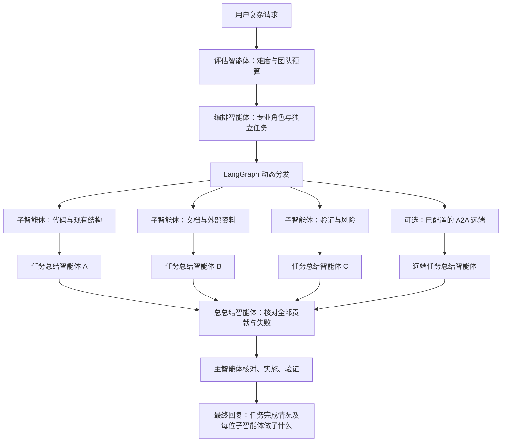

# Mobius 多智能体调度与 A2A 调研及接入

调研日期：2026-10-16。结论：Mobius 当前的 TypeScript / Continue 架构适合采用 **LangGraph JS 调度 + 官方 A2A JS SDK 通信 + 请求内结构化共享上下文**。本次已按这一组合接入源码；无需再配置一套模型 API Key。

本次依赖锁定为 `@langchain/langgraph@1.5.0`、`@a2a-js/sdk@1.3.0`。

## 开源项目比较

下表的“适合程度”和选型是结合 Mobius 代码后的工程判断。许可证以各仓库文件为准，升级时应再次核对，不能把商业托管产品的条款与开源核心混为一谈。

| 项目 | 能力与许可证 | 对 Mobius 的取舍 |
| --- | --- | --- |
| [LangGraph JS](https://github.com/langchain-ai/langgraphjs) | MIT；图状态、动态任务分发、并行节点、结果 reducer；支持独立模型实现 | **本次采用**。只使用调度层，复用 Continue 模型与工具，不替换现有聊天循环 |
| [Deep Agents](https://github.com/langchain-ai/deepagents) | MIT；基于 LangGraph 的完整 agent harness，包含规划、子智能体和文件系统抽象 | 适合从零构建完整 agent。Mobius 已有工具、技能、编辑与验证循环，整体替换会重复这些能力 |
| [Microsoft Agent Framework](https://github.com/microsoft/agent-framework) | MIT；Python/.NET 多智能体、并发、handoff、工作流和 A2A 集成 | 企业后端服务候选；当前桌面直接集成需要额外运行时与桥接。没有选用旧 AutoGen 作为新增基础 |
| [Google ADK](https://github.com/google/adk-python) | Apache-2.0；[ParallelAgent](https://adk.dev/agents/workflow-agents/parallel-agents/) 和其他工作流智能体；A2A 集成 | 适合独立专业 agent 服务，再由 Mobius 通过 A2A 调用；现阶段不增加 Python 调度服务 |
| [CrewAI](https://github.com/crewAIInc/crewAI) | MIT；角色、任务和[层级调度](https://docs.crewai.com/en/concepts/processes) | 适合固定角色的业务流程；层级 process 不应直接理解为所有任务都并发。Mobius 更需要动态拆题和现有 IDE 工具复用 |
| [Mastra](https://github.com/mastra-ai/mastra) | TypeScript；agent、workflow、memory；[核心 Apache-2.0，ee 目录单独许可](https://github.com/mastra-ai/mastra/blob/main/LICENSE.md) | 同语言的可选方案，但接入其完整 agent/memory 层重叠较多；没有引入 ee 组件 |

LangGraph 官方的 [orchestrator-worker 模式](https://docs.langchain.com/oss/javascript/langgraph/workflows-agents#orchestrator-worker) 使用 `Send` 动态生成 worker，每个 worker 有独立状态，结果写入共同的归并通道。Mobius 采用这个模式，加上显式并发闸门，避免把“生成了多个任务”误当成“受控并发”。

## 通信、上下文与记忆协议的边界

| 方案 | 解决的问题 | Mobius 中的用法 |
| --- | --- | --- |
| [A2A](https://a2a-protocol.org/) | 不同框架或服务之间的智能体发现、消息、任务状态与结果交付 | 接入官方 [A2A JavaScript SDK](https://github.com/a2aproject/a2a-js)，当前实现 A2A 1.0 JSON-RPC 客户端 |
| [MCP](https://modelcontextprotocol.io/specification/) | 智能体访问工具与数据资源 | 继续沿用 Mobius 已有 MCP 集成。需要共享知识库时，可用 MCP 暴露检索资源；MCP 本身不会自动同步各 agent 的记忆 |
| [LangGraph State](https://docs.langchain.com/oss/javascript/langgraph/thinking-in-langgraph) | 应用内部的结构化状态与归并 | 当前共享任务上下文快照、任务清单、带来源的成果与失败；每次请求独立，避免整个聊天记录在所有 worker 中复制 |
| [AG-UI](https://github.com/ag-ui-protocol/ag-ui) | 智能体后端与前端的事件、状态同步 | 可用于后续可视化任务树，但不是智能体之间共享记忆的协议，本次沿用原生聊天进度接口 |
| [AGNTCY SLIM](https://github.com/agntcy/slim) | 面向智能体协议的安全消息传输，可承载 A2A/MCP | 多组织、大规模远程 agent 网络的后续候选；桌面内调度不需要额外部署路由服务 |

**A2A 的 contextId 不是一个“自动共享上下文窗口”。** 它关联远端会话中的任务与消息。首次调用由远端分配 contextId；继续同一远端会话时才回传其返回的 ID。本地调度 run ID 通过 metadata 关联，不冒充远端会话 ID。A2A 允许对方保留内部实现和记忆的不透明性，不要求公开思维链或内部消息历史。[协议说明](https://a2a-protocol.org/latest/)

本次共享上下文使用应用拥有的显式快照与成果归并。它支持父子之间的上下文交付，不是多个 agent 任意读写同一可变聊天数组；当前也没有跨重启持久记忆或 sibling 实时广播。这些需求应在后续通过带作用域、版本、来源的存储服务实现，再通过 MCP 提供按需访问。

## 已落地的运行流程



- 工作台 Agent 模式中，被现有意图判定识别为复杂调查或代码修改的请求，先调用调度再进入原有主循环。简单修改、轻量任务和 Chat 模式保持原路径。设置 `continue.multiAgent.enabled = false` 可关闭自动预调研。
- Continue 工具列表新增 `orchestrate_agents`、`list_a2a_agents`、`call_a2a_agent`。Continue 面板依照系统提示选择调度工具；工作台的复杂任务由代码主动调度。
- 工作台调度使用用户所选模型；工具调用优先使用 Continue 的 subagent 角色模型，否则使用当前聊天模型。所选模型未在 Continue 中找到时明确降级，由主智能体继续，不悄悄换成另一个模型。
- `continue.multiAgent.maxParallelAgents` 可设置为 **5–10**，默认 **10**；Continue 工具可用 `max_agents` 指定同样的上限。这里限制的是同时运行的专业分支数量，评估、编排和总总结按顺序执行；每个分支内执行与总结也按顺序进行。
- 评估智能体首先独立调用模型，输出难度、人数预算与理由：简单任务通常 1–2 个，中等 3–4 个，复杂 5–7 个，高复杂度 8–10 个；最终人数受用户配置上限约束。编排智能体根据实际任务选择专业角色，不能超过预算，也不为了凑数制造重复任务。
- 每项任务都有独立 `taskId`、专业 `role`、任务 `title` 和执行要求。角色随请求决定，例如架构、代码分析、测试、性能、安全、集成、通信协议、文档；不是固定把同一个提示重复十次。
- 每个专业分支执行后，单独的任务总结智能体只接收该任务及其有界证据，整理实际做过的工作、发现、来源与未完成项；待所有分支完成，再由总总结智能体整理全部贡献、冲突和失败。总结智能体使用独立模型调用且没有工具。
- 每个 worker 最多 5 轮工具推理、8 次工具调用，必要时另做一次无工具证据整理；此外，每个任务固定经过一次独立总结，全部任务再经过一次总总结。整次流程限时 **300 秒**。共享快照最多 8000 字符，每份原始成果最多 6000 字符，每份任务总结最多 1200 字符。
- 本地 worker 只得到允许自动执行的只读工具白名单：文件读取、目录/文件名搜索、内容搜索、网页检索和页面读取。不会得到终端、文件写入、MCP 任意工具或再次调度的权限；涉及工作区外读取的工具策略仍会拦截。
- 每个 worker 的消息数组独立。工作台为本次 cwd 创建 IDE 读取视图，不修改全局工作目录；多个聊天不会因为调研而相互切换 cwd。
- 单个 worker 失败保留其他成果；单项总结失败保留原始证据；总总结失败仍返回逐项贡献记录。执行状态、总结状态和整个子任务阶段状态分别由程序记录，不能被总结模型写成“成功”。取消或超时停止后续阶段，不能采用迟到结果。
- 工作台展示固定格式的贡献表，逐项列出专业角色、分配任务、实际贡献和失败；主智能体最后回复也被要求说明每位子智能体做了什么。工具结果中的 `phase: "research"`、`taskCompleted: false` 表明这是只读分析阶段；主任务完成状态以实际代码修改和验证为准。调度本身不可用时，聊天会提示并由主智能体继续。
- 取消会传给模型、A2A 网络请求和队列。如果底层只读工具忽略取消，已经开始的底层读取可能仍会结束，但不会启动后续步骤或采用迟到结果。远端任务取消是尽力而为。
- 增加模型调用会增加用量；并行只缩短可重叠部分，不能保证总成本下降或每个任务都更快。

源码入口：`continue/core/agents/`、`continue/core/tools/implementations/orchestrateAgents.ts`、`continue/extensions/vscode/src/agent/orchestration.ts`、`vscode/src/vs/workbench/contrib/continue/browser/continueOrchestration.ts`。

## 配置 A2A 远端

将 `config/a2a-agents.json.example` 复制为用户目录的 `~/.continue/a2a-agents.json`，编辑端点与说明。配置从用户目录读取，不从项目内容或模型输出创建；默认没有任何远端。

```json
{
  "agents": [
    {
      "id": "research",
      "description": "Read-only research agent returning cited findings",
      "cardUrl": "https://agents.example.com/.well-known/agent-card.json",
      "tokenEnv": "MOBIUS_RESEARCH_A2A_TOKEN",
      "allowDelegation": false
    }
  ]
}
```

`cardUrl` 指向完整 Agent Card URL。只支持 HTTPS，环回地址可用 HTTP；不接受 URL 内嵌凭据，不跟随重定向，Agent Card 宣告的 JSON-RPC 地址必须与其同源。需要认证时设置独立的 `tokenEnv` 环境变量，并重启 IDE 以继承环境；公开服务可以省略该字段。不会将模型供应商的 API Key 或请求头传给远端。

先用 `list_a2a_agents` 检查 ID，再以 `call_a2a_agent` 提供明确 prompt；后续对话可使用它返回的 contextId。仅当用户将 `allowDelegation` 改成 `true`，调度智能体才可自主分配任务给该远端。这个开关表示允许向该服务发送子任务，需选择可信、只读的专业服务；本地无法强制控制远端内部工具。

当前会等待 submitted/working 任务并轮询最终结果，返回文本 artifact。failed/canceled/input-required 等状态明确报告，不伪装成 completed。本次未开放公网入站服务、未增加 gRPC/REST 或 0.3 兼容、未启用 push notification，也不自动访问 artifact URL。

## 可复现验证

```powershell
Set-Location E:\MobiusCode\Mobius
npm --prefix continue/core ci
npm --prefix continue/core run vitest -- agents/orchestrator.vitest.ts agents/a2a.vitest.ts tools/implementations/orchestrateAgents.vitest.ts
npm --prefix continue/core run tsc:check
npm run check
npm run compile
```

测试使用真实 LangGraph 与真实官方 SDK，加上本地 HTTP A2A fixture 和可控模型流；不依赖云端密钥。覆盖并发上限、归并、错误保留、取消、输出限制、流式工具调用、权限隔离、远端任务生命周期及端点限制。工作台路由与取消桥接测试位于 `vscode/src/vs/workbench/contrib/continue/test/browser/continueOrchestration.test.ts`。

这些测试不证明某个线上模型的规划质量，也不代表已经对用户的真实外部 agent 完成部署互通。需要实际模型账户和已部署端点才能验证那一层。完整构建及环境检查的本次结果记录在执行计划中。

首版接入的验证记录见 `2026-10-16-multi-agent-orchestration.md` 执行计划；评估、5–10 并发和两层总结升级的验证记录见 `2026-10-16-adaptive-agent-teams.md`。完整构建在本机以 `pwsh -NoProfile -File scripts/compile-vscode.ps1` 执行，避开旧 Windows PowerShell 的 Get-FileHash 问题。扩展单独的 CommonJS 类型检查有 7 处已知 OCR/初始化/编辑器类型错误，须与新增代码问题分开记录。

本轮升级有 112 项相关测试通过；核心/工作台类型检查、扩展打包、完整 IDE 构建和环境检查通过。十任务长编排结果、真实 5/10 并发、两层总结顺序、失败保留及取消均有测试覆盖。
