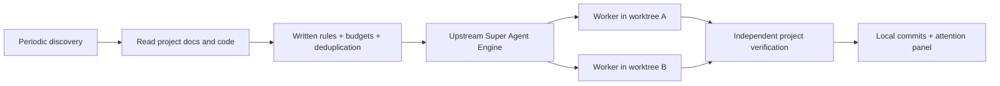

# Mobius continuous background coding

Mobius can inspect a project periodically, infer useful coding tasks under written rules, and execute them without a new chat request. A detached Node.js service keeps running after the IDE closes. The default is two concurrent workers, at most six new tasks and 24 discovery passes per UTC day. Discovery checks every 15 minutes until the daily budget is exhausted. Healthy operation sends no notifications; a local panel lists reviewable results and blockers.

The upstream [dsh-superagent-prototype](https://github.com/deepseek-ai/dsh-superagent-prototype) is pinned at `6337fc823ce20251c8de8085948165c81aaa701e`. Mobius directly imports its unmodified `src/core` Engine, authorization gates, Tickets, Assignments and stage calculation. `scripts/superagent/core.mjs` implements its Repositories port using SQLite transactions. This is a local project Source and Mobius model Executor, not the upstream GitHub/Feishu deployment or its full DSH web application. The upstream MIT license is retained and included in packaged clients.



## Start from Mobius

Install Node.js 24 and Git. Open a trusted local repository and configure a Mobius OpenAI-compatible model. Run **Mobius: Start Autonomous Background Coding** from the command palette. The command uses `loadContinueModels`, including the active `.env` profile / existing Continue model configuration, and passes its first active configured model to the detached process through environment variables. It does not require another API key. Changing a chat model temporarily does not change the background model; stop and restart after changing the active profile.

The terminal prints the loopback panel URL and policy path. **Mobius: Background Coding Status and Panel** shows that URL and current status again. **Pause Background Coding** stops new work and lets running workers finish. **Stop Background Coding** cancels active workers and stops the host; branches and worktrees remain. **Observe Coding Opportunities Only** switches an existing service to read-only discovery. No popup is emitted on each scan.

`mobius.superagent.nodePath` can select a Node 24 executable; `mobius.superagent.runtimePath` can select a source checkout's `scripts/superagent/cli.mjs`. Packaged Windows, Linux and macOS clients stage the adapter and upstream core automatically. Node 24 and Git remain external prerequisites.

## Project policy and verification

State is private to the repository's Git common directory: `<git-common-dir>/mobius-superagent/`. It is outside the tracked project and shared by its worktrees. `config.json` contains written rules and budgets, never API credentials. The default rule permits concrete bugs, missing regression coverage and incomplete documented work, and excludes speculative features, deployment and publishing. Edit the policy to define the project's actual priorities.

CLI initialization starts in `observe`; the explicit Mobius **Start Autonomous Background Coding** command starts in `auto`. Automatic execution requires a verification command. Initialization detects the first available npm script in `test`, `check`, `compile` order when npm can be resolved. Inspect and replace this with the project's meaningful build/test gates, especially if `check` only checks prerequisites. For a non-npm project, initialize the policy and enter program/argument arrays before enabling auto:

```json
{
  "version": 1,
  "mode": "auto",
  "intervalSeconds": 900,
  "maxParallel": 2,
  "maxTasksPerDay": 6,
  "maxDiscoveriesPerDay": 24,
  "taskTimeoutSeconds": 1800,
  "rules": [{"id": "project-quality", "instruction": "Fix reproducible defects documented in docs/ and tests. Preserve the public API."}],
  "verification": [["python", "-m", "pytest"]]
}
```

Discovery has read/list tools only. Each worker has a fresh Git branch and directory based on the main checkout's committed HEAD; uncommitted user changes are not included. Workers can read/write files and run local programs. The supervisor runs the configured verification independently, checks the diff, then makes a local commit. It does not merge or push. Review `execution.branch`, `execution.commit` and `execution.worktree` in status; cherry-pick or merge only after review. Submodules/dependencies are not automatically materialized in a fresh worktree; workers may need to initialize/install them, and failures remain visible.

Git worktrees prevent workers editing the same checkout. They are **not an OS security sandbox**: program execution has the launching user's permissions. Use a restricted account/container for untrusted projects. Files and tool output may be sent to the configured model provider. API credentials are not intentionally stored in policy or task records; use normal secret management for the model environment.

## CLI and recovery

From this checkout, run `npm run superagent -- <command> --repo <project>`. Standalone CLI startup reads `AI_MODEL`, `AI_API_KEY`, `AI_BASE_URL` (or their `OPENAI_*` equivalents) from the launching environment. The IDE entry point supplies these automatically.

| Command | Effect |
| --- | --- |
| `init` | Create policy in observe mode and print its location |
| `start` | Start detached, retaining the current mode |
| `start --auto` | Enable autonomous execution and start |
| `run` | Run in foreground for an OS service manager |
| `status` | Show status, panel URL, tasks and review branches |
| `pause` / `observe` / `auto` | Change scheduling mode |
| `stop` | Cancel active work, drain and stop |
| `retry <ticket-id>` | Retry a blocked/failed task in its retained worktree |
| `acknowledge <attention-id>` | Remove a handled attention item |

SQLite persists tasks, decisions, verification results, deduplication keys and daily budgets. Duplicate service instances are refused. After a crash, a running assignment with an uncertain outcome becomes blocked, rather than blindly replaying a shell command. Inspect retained work and any orphaned external commands, then retry it. Pending tasks can resume; changed written rules block tasks accepted under the old policy. Observed proposals can be reassessed after auto mode is enabled.

The service can run continuously while the machine is awake and online. It does not install a Windows service, scheduled startup task or systemd unit; for restart across reboot, supervise `run` using the host's service manager and supply model credentials through that manager. It is not a promise of execution during sleep, shutdown or a model-provider outage. Failed/blocked tasks require inspection/retry; there is no automatic merge or unbounded self-retry loop.

## Verification

`npm run superagent:test` exercises the actual upstream Engine, SQLite rollback, task budgets, duplicate suppression, two parallel real Git worktrees, independent verification failures, cancellation, and an actual detached host against a mock model HTTP server. No paid model calls or external GitHub messages are made by the tests. A live model quality/long-duration soak test is separate from these deterministic checks.
